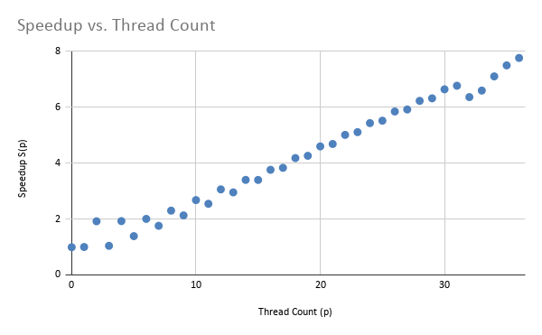
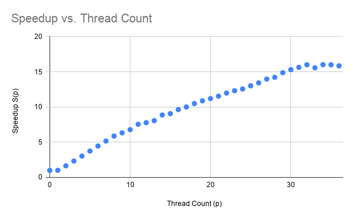

# Environment Setup and First Speedup Measurement

## Stage 0

```bash
lscpu
```

Architecture:                x86_64
  CPU op-mode(s):            32-bit, 64-bit
  Address sizes:             46 bits physical, 48 bits virtual
  Byte Order:                Little Endian
CPU(s):                      32
  On-line CPU(s) list:       0-31
Vendor ID:                   GenuineIntel
  Model name:                13th Gen Intel(R) Core(TM) i9-13900K
    CPU family:              6
    Model:                   183
    Thread(s) per core:      2
    Core(s) per socket:      24
    Socket(s):               1
    Stepping:                1
    CPU(s) scaling MHz:      22%
    CPU max MHz:             5800.0000
    CPU min MHz:             800.0000
    BogoMIPS:                5990.40
    Flags:                   fpu vme de pse tsc msr pae mce cx8 apic sep mtrr pge mca cmov pat pse36 clflush dts acpi mmx fxsr sse sse2 ss ht tm pbe syscall nx pdpe1gb rdtscp lm constant_ts
                             c art arch_perfmon pebs bts rep_good nopl xtopology nonstop_tsc cpuid aperfmperf tsc_known_freq pni pclmulqdq dtes64 monitor ds_cpl vmx smx est tm2 ssse3 sdbg f
                             ma cx16 xtpr pdcm pcid sse4_1 sse4_2 x2apic movbe popcnt tsc_deadline_timer aes xsave avx f16c rdrand lahf_lm abm 3dnowprefetch cpuid_fault epb ssbd ibrs ibpb s
                             tibp ibrs_enhanced tpr_shadow flexpriority ept vpid ept_ad fsgsbase tsc_adjust bmi1 avx2 smep bmi2 erms invpcid rdseed adx smap clflushopt clwb intel_pt sha_ni 
                             xsaveopt xsavec xgetbv1 xsaves split_lock_detect user_shstk avx_vnni dtherm ida arat pln pts hwp hwp_notify hwp_act_window hwp_epp hwp_pkg_req hfi vnmi umip pku
                              ospke waitpkg gfni vaes vpclmulqdq rdpid movdiri movdir64b fsrm md_clear serialize pconfig arch_lbr ibt flush_l1d arch_capabilities
Virtualization features:     
  Virtualization:            VT-x
Caches (sum of all):         
  L1d:                       896 KiB (24 instances)
  L1i:                       1.3 MiB (24 instances)
  L2:                        32 MiB (12 instances)
  L3:                        36 MiB (1 instance)
NUMA:                        
  NUMA node(s):              1
  NUMA node0 CPU(s):         0-31
Vulnerabilities:             
  Gather data sampling:      Not affected
  Indirect target selection: Not affected
  Itlb multihit:             Not affected
  L1tf:                      Not affected
  Mds:                       Not affected
  Meltdown:                  Not affected
  Mmio stale data:           Not affected
  Old microcode:             Not affected
  Reg file data sampling:    Mitigation; Clear Register File
  Retbleed:                  Not affected
  Spec rstack overflow:      Not affected
  Spec store bypass:         Mitigation; Speculative Store Bypass disabled via prctl
  Spectre v1:                Mitigation; usercopy/swapgs barriers and __user pointer sanitization
  Spectre v2:                Mitigation; Enhanced / Automatic IBRS; IBPB conditional; PBRSB-eIBRS SW sequence; BHI BHI_DIS_S
  Srbds:                     Not affected
  Tsa:                       Not affected
  Tsx async abort:           Not affected
  Vmscape:                   Mitigation; IBPB before exit to userspace


## Stage 1: Get, Build, and Verify the code

```bash
tar xvf ~cs475/provided/Labs/Lab0-Mandelbrot-starter.tar
blowfish:~/cs475/Lab0$ OMP_NUM_THREADS=4 ./bin/Mandelbrot.check-par
The total number of errors is 0
```

## Stage 2: What is Speedup

// informational stage without a deliverable

S(p) = T(baseline) / T(p)

speed gained from prarallization = fully serial / num of runtime threads

note: speed( parallel program ran with 1 thread != serial program) 

## Stage 3: Run the Sweep

```bash
./bin/sweep.sh -pmin 1 -pmax 36 -r 5 -o default_range.csv
./bin/make_excel.sh default_range.csv default_range.xlsx
```



## Stage 4: Run the Sweep on a Different Viewing Window

```bash
./bin/sweep.sh -pmin 1 -pmax 36 -r 5 -o alt_range.csv -a -0.8 -b -0.7 -c 0.05 -d 0.15
./bin/make_excel.sh alt_range.csv alt_range.xlsx
```



## Stage 5

1. Why isn't the scatterplot smooth?
2. Why is the scatterplot from stage 4 smoother than the one from Stage 3?
3. Why would a parallel program ran with a single thread sometimes run faster than its fully serial counterpart?